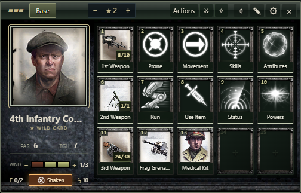
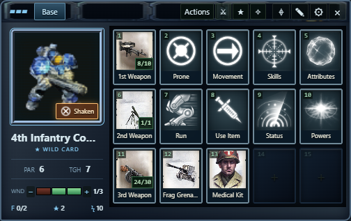
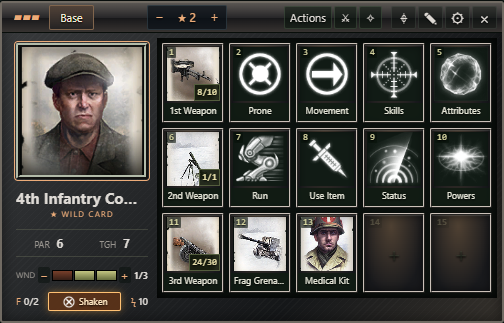
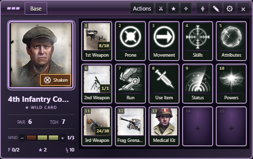
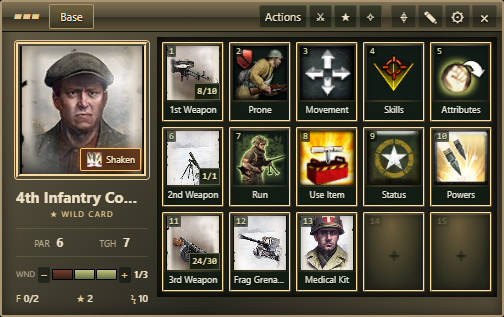
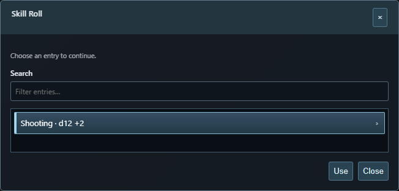

# RTS Combat Grid · SWADE

A compact RTS command panel for **Foundry VTT 13.339+ / 13.x**, **SWADE 5.x**, and **SWADE Tools 2.2.2+**. Open a token's normal HUD, then click its **grid icon**. Right-clicking a token alone does not open this panel. Argon and Token Action HUD are not required.

The module interface and documentation are in **English**. Actor names, item names, custom labels, and system condition names keep their original text.

## Installation

In Foundry's **Add-on Modules → Install Module**, paste:

```text
https://github.com/UmutcanOrug/rts-combat-grid/releases/latest/download/module.json
```

Enable **SWADE Tools** and **RTS Combat Grid · SWADE** in your world. The manifest points to the author's [SWADE Tools build](https://github.com/UmutcanOrug/swade-tools-fix/releases), which provides the weapon panel used by this grid.

For an existing installation, check for module updates and reload the world. Manual installation: extract the release ZIP into your user data's `Data/modules` folder. The manifest belongs at `Data/modules/rts-combat-grid/module.json`.

## One Base page

The default 5 × 3 grid uses this arrangement. Every slot can be reassigned, cleared, moved, or given a custom icon.

| | Column 1 | Column 2 | Column 3 | Column 4 | Column 5 |
| --- | --- | --- | --- | --- | --- |
| Row 1 | 1st Weapon | Movement | Run | Prone | Use Item |
| Row 2 | 2nd Weapon | Skills | Attributes | Status | Powers |
| Row 3 | 3rd Weapon | Custom item | Custom item | Custom item | Custom item |

Version 0.3.2 applies this default to new actors and upgrades the original 5 × 3 Base command order on existing actors. Command icons, labels, Movement voice macros, weapon assignments, custom items, and extra pages are retained. Manually rearranged or resized layouts keep their saved positions.

**All Weapons** (crossed weapons in the header) opens **Weapon Loadout** with three selectors: 1st Weapon, 2nd Weapon, and 3rd Weapon. Choose any owned weapon, Automatic, or Empty, then Save Loadout. This updates the three left-hand Base slots and saves the assignments with the layout. Automatic mode prefers equipped weapons and recognizes a pistol/sidearm for the third slot.

The four bottom slots start empty for grenades, consumables, macros, or any other commands. Drag actor items onto them or Shift-click to assign an entry. **Use Item** lists available gear and consumables; cards retain the system's normal use controls. The grid does not invent or automatically spend consumable quantities.

**Actions** is always visible in the header. It lists actor Action items, additional weapon/power actions, available Aim/Defend/Hold/Wild Attack statuses, and Support/Test and recovery roll shortcuts. **Browse Action Library** finds accessible Action items in world items and installed Item compendiums. Using a library entry explicitly adds a copy to this actor and opens it in SWADE Tools. Rules content is supplied by your installed SWADE content; this module does not bundle rulebook Action items.

**Shaken** is a dedicated toggle in the lower portrait card, between Fatigue and Power Points. It shows whether Shaken is active and leaves the portrait and all four custom item slots clear. The header includes Benny controls (remove, spend/count, add) and Effects. Click the portrait to open the character sheet. Base and any custom page tabs share the header; there is no duplicate Sheet/Target toolbar or instructional footer.

## Five themes

**CoH II · Frontline** and **SC II · Terran** include selected interface textures from the author's locally installed games.





**Ironclad**, **Arcane**, and **Desert** use original styling.







All five themes use the actual extracted **StarCraft II command icons by default**. Previously saved Follow theme/Automatic icon settings also resolve to SC II. Run uses the Charge legs icon; Movement uses the Move arrow, and Use Item uses Stimpack. The SC II theme includes its original game button frames again. CoH II icons remain an optional explicit choice under **Command icon set**. Individual custom slot icons are preserved. The icon library also retains the original extracted unit and ability images. Choose your own images, background, portrait, transparent button frame, accent color, and button labels. Each actor can use a different theme; the GM sets the default for new actors. See [asset sources](assets/SOURCES.md).

## NPC defaults and Token Configuration

An unlinked Extra has its own synthetic actor. Editing its grid saves that token's layout; it does not automatically update the world actor or its prototype token.

For reusable NPCs, configure one token, then choose either:

- **Panel Settings → Save as NPC Default**, which saves the edited panel and the reusable default together.
- **Token Configuration → Identity → RTS Combat Grid → Save as NPC Default**. The same section is available in Prototype Token Configuration. If a token of this actor is open in the grid, its displayed layout is the source.

This GM-only command saves the layout to the base actor and its prototype token. New linked and unlinked tokens from that actor inherit it. The base actor keeps a separate portable default, so using Foundry's Assign Token does not erase the module's fallback. Weapon and item bindings can be matched after item IDs change. Assigned items that only exist on the source Extra are copied to the base actor; existing actor items are not rewritten. Wounds, resources, permissions, and token linking are not copied or changed.

Existing Extras keep their own edited layouts. In their Token Configuration, click **Use NPC Default** to replace this token's layout with the saved default. Save a new NPC default whenever you want later tokens to use a revised layout.

## Choice windows and positioning

Skill, attribute, Action, power, item, status, and effect windows use a searchable, scrollable list of clickable rows. Select a row and click Use. Arrow keys move between visible entries; search filters the list. These windows use styling consistent with SWADE Tools and avoid the host's fixed-height native select listbox.

Skill and attribute entries include the prepared bonus shown on the character sheet, such as **Shooting · d12 +2**. The display includes the trait's die modifier, active effect modifiers, and applicable attribute/trait global modifiers, while ignoring disabled entries. The same notation appears in assigned skill/attribute tooltips. Rolls still use SWADE Tools with the original skill ID or attribute key; the displayed bonus is not added a second time.



The grid launcher is the **first button in the token HUD's left column**. The panel also starts on the left side of the screen. A manually saved panel position is retained; use Panel Settings → Reset position to return to the new left default. Argon can remain enabled or be disabled independently.

## Wounds

The portrait card uses the actor's actual wound capacity, including zero for ordinary Extras and modified capacities for other actors. Click a segment to set the wound count; clicking the last filled segment removes it. Small **− / +** controls remove or add one wound, just like the actor sheet.

An Extra with zero wound capacity has a compact READY/DOWN indicator instead of three fake bars. Values above capacity show incapacitation on the card. Wound changes update `system.wounds.value`; SWADE and SWADE Tools own penalties and configured status automation. This is a manual wound control, not a damage/soak resolver. Status conditions remain available through Status.

## Movement and voice macros

**Movement** selects this token and activates the normal token movement tool. It does not spend movement or move the token automatically.

Shift-click the Movement button and choose an optional **Movement voice macro**. Click Movement, then move the token normally: the macro runs once after this user's next confirmed position change for this token. Another user's movement does not trigger it. Closing the panel, switching to another token, or changing scenes cancels the pending movement voice.

The macro receives `{actor, token, tokenDocument, from, to}`. `from` and `to` contain scene coordinates. This allows your own speech, audio, or animation macros to react to an RTS movement command.

Two hooks are also available:

- `rtsCombatGridMovementArmed(scope)` fires when Movement is clicked.
- `rtsCombatGridMovement(scope)` fires once on the subsequent movement, even without an assigned macro.

## Controls and editing

| Control | Result |
| --- | --- |
| Token HUD grid icon | Open/close this token's panel |
| Left-click a slot | Use its assigned item or command |
| Right-click a slot | Attack/use, damage, reload, chat card, item sheet, additional item actions, or edit |
| Pencil | Toggle edit mode; click to assign/clear; drag to swap |
| Shift-click a slot | Edit directly |
| Drag from actor sheet | Assign that actor's item |
| Drag a world macro | Assign an executable macro |
| Gear | Appearance, grid size, pages, import/export |
| Pin | Keep the panel on this token |
| Drag header background | Move the panel |
| Escape or × | Close |
| Ctrl + Shift + R | Toggle the selected token's panel |
| Alt + 1…9 | Optional first-nine-slot shortcuts, enabled in module settings |

Layouts are stored at `flags.rts-combat-grid.grid`. Linked tokens share their actor's layout; unlinked tokens use their synthetic actor. Panel position is saved per user. The unpinned panel can follow the selected token and closes on ownership loss or a scene change.

The editor supports 3–8 columns, 2–6 rows, 40–96 px buttons, and up to 12 custom pages. Shrinking the grid preserves hidden slots. Add page names on separate lines; removing a line removes that page's buttons. **Rebuild layout from actor items → Save** restores the single Base layout. JSON import/export transfers appearance and ID-based bindings; reassign missing items when importing to another actor.

Version 0.1 default category tabs migrate to Base. Custom pages and custom buttons are retained; customized buttons from old default tabs appear in Saved Buttons pages. Export before rebuilding if you want to keep a separate copy.

## SWADE Tools integration

Weapons and powers call `game.swadetools.item` with the exact selected token. Action items use the public `game.swade.swadetoolsAttack(actor, item, true)` dialog bridge. Skill, attribute, and running rolls use `game.swadetools.skill`, `.attribute`, and `.run`. Reload and item cards use their native item operations.

SWADE Tools owns range, RoF, modifiers, attack/damage rolls, ammunition, and Power Point consumption. The grid opens its dialogs rather than rolling or consuming those resources a second time. An additional item action is highlighted and made the default in the matching Tools dialog; the player still confirms it there.

Status toggles actual actor conditions. Effects enables/disables editable active effects. **Add a Benny** awards one through SWADE, like the actor sheet. **Remove a Benny** reduces the counter directly, clamps at zero, and does not run spending hooks or transfer a Benny through Hard Choices. The middle star/count button remains **Spend a Benny**, with the native spending behavior; it does not automatically soak or reroll. These controls are available to the actor owner and GM. Give a Benny is available in the editor for GMs only. Macros retain the current user's execution permissions.

## Validation

Automated tests cover the Base arrangement, migration, ownership, Tools delegation, actual Action items, additional-action dialog selection, macros, movement arming, wounds, and layout validation, portable NPC defaults, item-ID rebinding, token-only assigned items, and GM permissions. Browser checks exercise all five themes, player commands, Action selection, wound segments and Extras, one-shot movement voice, editing/import/dragging, the launcher, ownership loss, and small viewports. Additional checks cover SC II icons across all themes, restored SC II frames, the lower Shaken toggle, sheet-equivalent skill bonuses, separate Benny add/remove/spend behavior, selecting all entries in a long choice list, three-weapon assignment, and NPC default controls.

Browser checks use a simulated Foundry/SWADE Tools host. API signatures were checked against local Foundry V13, SWADE 5.0.8, and the author's SWADE Tools 2.2.2 source. A live Foundry world is still needed to verify real dice dialogs and interaction with other enabled modules. Foundry V14 is outside this release's scope.

## Development

- `npm test` — core, action, and English-interface checks.
- `npm run preview` — local interface preview at `http://127.0.0.1:4176`.
- `npm run package` — build the installable ZIP in `dist/`.
- `tools/browser-check.mjs` — UI checks with Playwright and Chrome.
- `tools/verify-package.py` — ZIP structure, manifest paths, and asset verification.

Full game archives, extraction libraries, and local Foundry system files are excluded from the repository and ZIP. Normal builds use the prepared assets.
